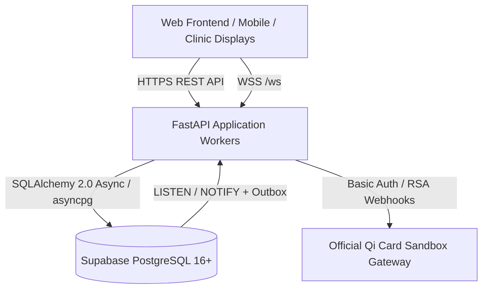

# Al-Jadreyah Clinic Management System — System Architecture

## 1. High-Level Architecture Overview

The Al-Jadreyah Clinic Management System backend is an enterprise-grade healthcare management application designed for high availability, absolute data integrity, and strict patient privacy.

### Key Stack Components
- **Runtime:** Python 3.12+ (Typed, Asynchronous).
- **Web Framework:** FastAPI (ASGI with Uvicorn multi-worker deployment).
- **ORM / Database Access:** SQLAlchemy 2.0 Async with `asyncpg` driver.
- **Relational Storage:** PostgreSQL 16+ (Supabase pooler in production, SQLite in-memory/file in test suites).
- **Real-Time Distribution:** PostgreSQL-Only transactional outbox with `pg_notify` and worker recovery polling (Strictly zero Redis).
- **Payment Gateway:** Official Qi Card Sandbox (`https://uat-sandbox-3ds-api.qi.iq/api/v1`).
- **Object Storage:** Authenticated Supabase Storage with signed short-lived HMAC/JWT token authorization for medical documents.

---

## 2. Infrastructure Principles: Zero Redis Architecture

Redis is strictly prohibited throughout this architecture:
1. **Shared State:** All distributed state (tickets, outbox events, rate limit counters) is centralized in PostgreSQL.
2. **Multi-Worker Safety:** Eliminates worker memory partitioning vulnerabilities by persisting connection tickets (`realtime_connection_tickets`) and transactional outbox events (`outbox_events`) in the database.
3. **Operational Simplicity:** Eliminates dual-datastore synchronization anomalies, Redis replication lags, and uncommitted phantom event deliveries.

---

## 3. Real-Time Event Engine

The real-time architecture consists of three integrated layers:
1. **Transactional Outbox (`outbox_events`):** Every domain event (`appointment.booked`, `visit.started`, `doctor.late`, `lab.result_confirmed`) is written to `outbox_events` within the active business database transaction. If the transaction rolls back, no event is persisted.
2. **PostgreSQL Trigger Notification:** A PostgreSQL trigger `trg_outbox_event_notify` calls `pg_notify('realtime_events', NEW.id::text)` on commit, alerting listening workers immediately.
3. **Worker Cursor & Delivery Engine:** Each worker maintains an independent `last_seen_event_id` cursor. Workers listen on the notification channel and periodically poll every 500ms (`REALTIME_POLL_INTERVAL_SECONDS`) to guarantee zero event loss across reconnections or network interruptions. Events are fanned out to active WebSockets connected to that worker.

---

## 4. Payment Gateway Integration (Qi Card Sandbox)

Online payments are processed through the official Qi Card Sandbox environment:
- **Base URL:** `https://uat-sandbox-3ds-api.qi.iq/api/v1`
- **Merchant Credentials:** `paymentgatewaytest` / `WHaNFE5C3qlChqNbAzH4` / Terminal `237984`.
- **Authentication:** HTTP Basic Auth with `X-Terminal-Id` header.
- **Financial Precision:** Strict `Decimal` arithmetic throughout invoice and transaction calculation to eliminate floating-point rounding errors.
- **Webhook Security:** RSA-SHA256 signature verification over canonical string `paymentId|amount.000|currency|creationDate|status`. Authoritative server-to-server reconciliation via `GET /payment/{id}/status` before invoice settlement.
