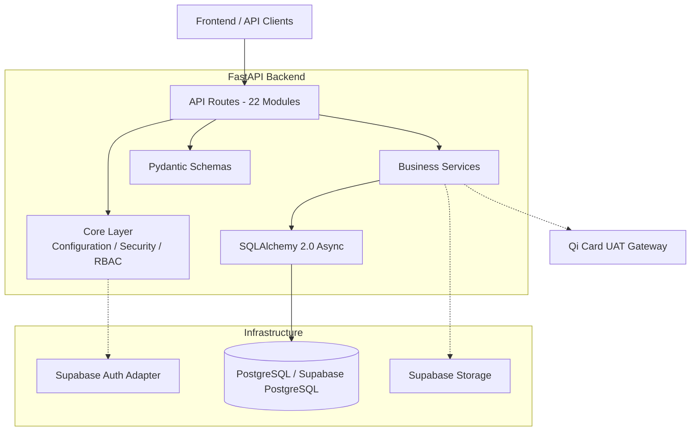
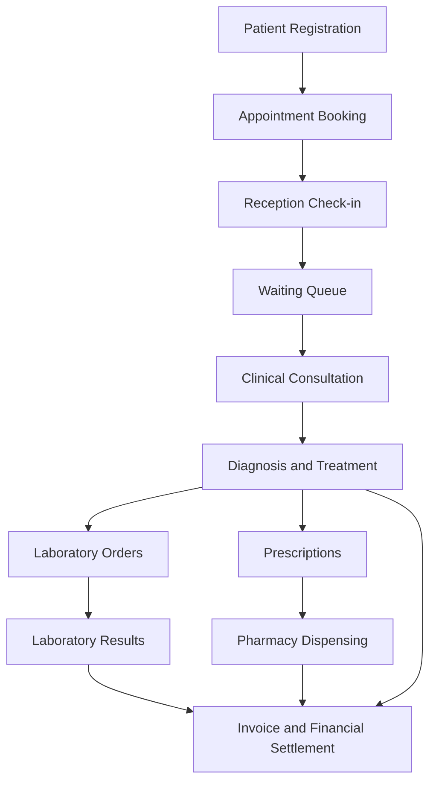

# Al-Jadreyah Clinic Management System — Backend API

<div align="center">

**A modular healthcare management backend built with FastAPI, asynchronous SQLAlchemy, and PostgreSQL.**

A comprehensive REST API powering patient management, clinical workflows, appointment scheduling, laboratory operations, pharmacy inventory, financial management, and multi-role clinic administration.

[](https://www.python.org/)
[](https://fastapi.tiangolo.com/)
[](https://www.postgresql.org/)
[](https://www.sqlalchemy.org/)
[](https://docs.pydantic.dev/)
[](https://www.docker.com/)
[](https://supabase.com/)
[](https://github.com/team-1-aljadreyah/backend/actions/workflows/ci.yml)

[Architecture](#architecture) · [Features](#key-features) · [Installation](#installation) · [API-reference](#api-reference) · [Documentation](#documentation)

</div>

---

## Table of Contents

- [Overview](#overview)
- [Key Features](#key-features)
- [Architecture](#architecture)
- [Technology Stack](#technology-stack)
- [Project Structure](#project-structure)
- [User Roles](#user-roles--access-control)
- [Prerequisites](#prerequisites)
- [Installation](#installation)
- [Environment Configuration](#environment-configuration)
- [Database Setup](#database-setup)
- [Running the Application](#running-the-application)
- [API Reference](#api-reference)
- [API Usage Examples](#api-usage-examples)
- [Authentication and Security](#authentication-and-security)
- [Database Integrity and Concurrency](#database-integrity-and-concurrency)
- [External Integrations](#external-integrations)
- [Testing and Code Quality](#testing-and-code-quality)
- [Docker and Deployment](#docker-and-deployment)
- [CI/CD](#continuous-integration-and-deployment)
- [Documentation](#documentation)
- [Contributing](#contributing)
- [Security Disclosure](#security-disclosure)
- [License](#license)

---

## Overview

The **Al-Jadreyah Clinic Management System Backend** is a modular REST API designed to support the operational and clinical requirements of multi-specialty outpatient medical centers.

It provides a centralized backend for managing the complete patient journey, from registration and appointment booking to clinical consultations, diagnostic services, prescription fulfillment, pharmacy operations, and financial settlement.

The system is designed around clearly separated business domains, asynchronous database access, role-based authorization, and PostgreSQL-level data integrity mechanisms.

### Core Objectives

- Centralize patient records and clinical information.
- Coordinate doctors, receptionists, laboratory technicians, and pharmacy staff.
- Automate appointment scheduling and waiting-room workflows.
- Prevent conflicting doctor appointments under concurrent requests.
- Maintain traceable financial transactions and accounting operations.
- Support family-based patient accounts.
- Reduce duplicate patient records through Arabic name and phone normalization.
- Provide a consistent API contract for frontend applications.

### Supported Operational Areas

| Domain | Capabilities |
|---|---|
| Patient Management | Registration, family accounts, medical records, allergies, and medical alerts |
| Doctor Management | Profiles, specialties, working schedules, absences, and consultation durations |
| Appointments | Booking, cancellation, rescheduling, walk-ins, and check-ins |
| Waiting Queues | Ticket generation, emergency prioritization, and queue progression |
| Clinical Operations | Consultations, diagnoses, vital signs, and prescriptions |
| Laboratory | Test orders, structured results, attachments, and result confirmation |
| Pharmacy | Medicine inventory, dispensing, stock movements, and counter sales |
| Finance | Invoices, payments, refunds, reversals, and financial summaries |
| Accounting | General ledger, expenses, cash reconciliation, and doctor dues |
| Management | Staff administration, clinic configuration, analytics, and audit logs |
| Social Welfare | Welfare applications, document submission, and application reviews |
| Notifications | Patient and staff notifications and waiting-room information |

---

## Key Features

### 1. Patient Management and Medical Records

- Patient registration and profile management.
- Family-based patient account relationships.
- Medical history and clinical alerts.
- Allergy and chronic condition tracking.
- Blood group information.
- Arabic patient name normalization.
- Iraqi mobile phone number normalization.
- Duplicate patient detection.
- Non-destructive patient record merging.
- Historical patient record resolution.

### 2. Intelligent Patient Deduplication

The backend implements dedicated normalization mechanisms to improve patient identification and reduce duplicate medical records.

**Arabic name normalization includes:**

- Unifying Alef variants.
- Normalizing Taa Marbuta.
- Normalizing Yaa and Alef Maksura.
- Removing Arabic diacritics and Tatweel.
- Standardizing whitespace and letter representation.

**Phone normalization supports:**

- Iraqi local mobile formats.
- International `+964` prefixes.
- `00964` and `964` prefixes.
- Canonical local representation: `07XXXXXXXXX`.

The patient management service supports duplicate candidate detection and manager-controlled record merging.

Record consolidation uses a non-destructive approach that preserves the source record and records merge metadata for traceability.

### 3. Appointment Scheduling and Concurrency Protection

- Patient self-service booking.
- Reception-assisted booking.
- Walk-in registration.
- Doctor-specific consultation durations.
- Weekly doctor schedules.
- Multiple clinic branches.
- Appointment cancellation and rescheduling.
- Doctor absence and delay management.
- Deposit-related booking rules.
- Idempotency support for critical operations.

The database includes both exact-slot uniqueness protection and a PostgreSQL GiST exclusion constraint for overlapping appointment intervals.

### 4. Clinical Consultation Management

- Consultation lifecycle management.
- Diagnosis recording.
- Internal clinical notes.
- Vital signs collection.
- Digital prescription creation.
- Laboratory test requests.
- Imaging and procedure orders.
- Follow-up recommendations.
- Patient visit history.

### 5. Laboratory Management

- Laboratory order creation.
- Structured result entry.
- Result confirmation workflow.
- Reference ranges and measurement units.
- Result history.
- Medical attachment uploads.

Supported attachment formats include:

- PDF
- PNG
- JPEG

The current storage implementation enforces a maximum file size of 2 MB per uploaded file.

### 6. Pharmacy and Inventory Management

- Medicine catalog management.
- Barcode support.
- Stock receiving.
- Inventory adjustment.
- Low-stock monitoring.
- Expiry-date tracking.
- Prescription dispensing.
- Over-the-counter sales.
- Stock movement records.

### 7. Financial Management and Accounting

- Appointment-based invoicing.
- Multiple invoice line items.
- Iraqi Dinar (IQD) and US Dollar (USD) support.
- Cash and online payment workflows.
- Payment sessions.
- Refund and reversal operations.
- Expense management.
- Expense voiding.
- Reception cash management.
- Shift closing and reconciliation.
- Doctor revenue sharing.
- Financial ledger reporting.

Financial corrections are represented through explicit transactions rather than relying exclusively on destructive record updates.

### 8. Management and Administration

- Staff account management.
- Role-based permissions.
- Clinic settings.
- Operational analytics.
- Financial reports.
- Doctor dues reporting.
- Audit log access.
- Social welfare application review.

### 9. Waiting Room and Notifications

- Appointment arrival tracking.
- Queue ticket generation.
- Emergency priority.
- Doctor queue progression.
- Public waiting-room display.
- Doctor delay notifications.
- Appointment and laboratory notifications.

---

## Architecture

The application follows a modular, layered backend architecture.

Business logic is separated from HTTP routing, request validation, database models, and external service integrations.

### High-Level Architecture



The Supabase Auth component represents an available integration adapter; the inspected application login flow currently uses local profile credentials and application-issued JWTs.

### Application Layers

| Layer | Directory | Responsibility |
|---|---|---|
| API Layer | `app/api/routes/` | HTTP endpoints, dependencies, and request handling |
| Core Layer | `app/core/` | Configuration, authentication, permissions, exceptions, and idempotency |
| Service Layer | `app/services/` | Business rules and transaction orchestration |
| Schema Layer | `app/schemas/` | Request validation and response models |
| Database Layer | `app/database/` | SQLAlchemy models, connections, and sessions |
| Integration Layer | `app/integrations/` | External authentication, storage, and payment adapters |

### Clinical Workflow



---

## Technology Stack

| Technology | Purpose |
|---|---|
| Python 3.12+ | Primary programming language |
| FastAPI | Asynchronous REST API framework |
| Pydantic v2 | Request validation and serialization |
| Pydantic Settings | Environment configuration |
| SQLAlchemy 2.0 Async | Asynchronous ORM and database access |
| PostgreSQL 15+/16+ | Primary relational database |
| asyncpg | PostgreSQL asynchronous driver |
| SQLite | Local development and automated testing |
| aiosqlite | Asynchronous SQLite driver |
| Supabase | Optional authentication and storage integrations |
| JWT | Application access and refresh tokens |
| PBKDF2-HMAC-SHA256 | Application password hashing |
| Uvicorn | ASGI application server |
| HTTPX | Asynchronous HTTP integrations and API testing |
| Pytest | Automated testing |
| Pytest-Asyncio | Asynchronous test execution |
| Ruff | Python linting |
| Docker | Application containerization |
| Docker Compose | Container orchestration |
| GitHub Actions | Continuous integration |
| Jenkins | Deployment automation infrastructure |

Dependency versions and requirements are defined in:

- `pyproject.toml`
- `requirements.txt`
- `requirements-dev.txt`

---

## Project Structure

```text
backend/
│
├── app/
│   ├── main.py
│   │
│   ├── api/
│   │   └── routes/
│   │       ├── appointments.py
│   │       ├── audit.py
│   │       ├── auth.py
│   │       ├── cash.py
│   │       ├── doctors.py
│   │       ├── expenses.py
│   │       ├── health.py
│   │       ├── invoices.py
│   │       ├── lab.py
│   │       ├── ledger.py
│   │       ├── manager.py
│   │       ├── me.py
│   │       ├── patients.py
│   │       ├── payments.py
│   │       ├── pharmacy.py
│   │       ├── prescriptions.py
│   │       ├── public.py
│   │       ├── reports.py
│   │       ├── services.py
│   │       ├── settings.py
│   │       ├── users.py
│   │       └── welfare.py
│   │
│   ├── core/
│   │   ├── config.py
│   │   ├── dependencies.py
│   │   ├── envelope.py
│   │   ├── exceptions.py
│   │   ├── idempotency.py
│   │   ├── logging.py
│   │   ├── permissions.py
│   │   └── security.py
│   │
│   ├── database/
│   │   ├── base.py
│   │   ├── connection.py
│   │   └── models/
│   │       ├── appointment.py
│   │       ├── finance.py
│   │       ├── governance.py
│   │       ├── patient.py
│   │       ├── pharmacy.py
│   │       ├── profile.py
│   │       └── visit.py
│   │
│   ├── integrations/
│   │   ├── payment_provider.py
│   │   ├── qi_gateway.py
│   │   ├── supabase_auth.py
│   │   └── supabase_storage.py
│   │
│   ├── schemas/
│   │
│   └── services/
│
├── database/
│   └── schema.sql
│
├── tests/
│   ├── conftest.py
│   ├── test_appointment_concurrency.py
│   ├── test_appointments_and_queues.py
│   ├── test_auth_and_security.py
│   ├── test_clinical_and_lab.py
│   ├── test_concurrency_and_idempotency.py
│   ├── test_finance_and_accounting.py
│   ├── test_live_supabase_exclusion.py
│   ├── test_online_payments_and_welfare.py
│   ├── test_patient_merge_and_dedup.py
│   └── test_pharmacy_and_inventory.py
│
├── docs/
│   ├── API_DOCUMENTATION.md
│   ├── DATABASE_DESIGN.md
│   ├── DEPLOYMENT.md
│   ├── SECURITY.md
│   ├── SYSTEM_ANALYSIS.md
│   └── TEST_RESULTS.md
│
├── scripts/
│
├── .github/
│   └── workflows/
│       └── ci.yml
│
├── .env.example
├── .gitignore
├── .dockerignore
├── .python-version
├── pyproject.toml
├── requirements.txt
├── requirements-dev.txt
├── Dockerfile
├── docker-compose.yml
├── compose.production.yaml
├── Jenkinsfile
├── CONTRIBUTING.md
├── SECURITY.md
├── CHANGELOG.md
└── README.md
```

---

## User Roles & Access Control

The backend supports seven distinct application roles.

| Role | Primary Responsibilities |
|---|---|
| `patient` | Personal medical records, family management, appointments, and patient services |
| `reception` | Patient registration, appointment management, check-in, walk-ins, and reception operations |
| `doctor` | Clinical consultations, diagnoses, prescriptions, and assigned patient workflows |
| `pharmacy` | Medicine inventory, prescription dispensing, and pharmacy sales |
| `lab` | Laboratory orders, test results, and diagnostic attachments |
| `accountant` | Financial records, reconciliation, accounting operations, and payment reversals |
| `manager` | Administrative operations, staff management, clinic settings, reporting, and patient record merging |

Authorization is implemented through application dependencies and role-based permission checks.

Individual endpoint permissions should always be verified through the relevant route implementation.

---

## Prerequisites

Before running the application, ensure the following tools are available:

| Requirement | Version |
|---|---|
| Python | 3.12 or newer |
| pip | Recent version |
| Git | Recent version |
| PostgreSQL | 15+ when using PostgreSQL |
| Docker | Optional |
| Docker Compose | Optional |

SQLite is supported for local development and automated testing.

PostgreSQL is the intended primary database for the complete relational schema and its database-specific constraints.

---

## Installation

### 1. Clone the Repository

```bash
git clone https://github.com/team-1-aljadreyah/backend.git

cd backend
```

### 2. Create a Virtual Environment

**Linux / macOS**

```bash
python3.12 -m venv .venv

source .venv/bin/activate
```

**Windows PowerShell**

```powershell
py -3.12 -m venv .venv

.venv\Scripts\Activate.ps1
```

### 3. Install Development Dependencies

```bash
python -m pip install --upgrade pip

pip install -r requirements-dev.txt
```

For production dependencies only:

```bash
pip install -r requirements.txt
```

### 4. Configure Environment Variables

Create your local environment file:

```bash
cp .env.example .env
```

For a standalone SQLite development setup, set:

```env
APP_ENV=development
APP_DEBUG=false
APP_TIMEZONE=Asia/Baghdad
DATABASE_URL=sqlite+aiosqlite:///./clinic.db
SECRET_KEY=replace-with-a-secure-random-secret-of-at-least-32-characters
```

For PostgreSQL, configure `DATABASE_URL` with your actual database connection string.

Never commit your `.env` file.

---

## Environment Configuration

The following table reflects the configuration model in `app/core/config.py`. Values in `.env.example` may intentionally differ from code defaults.

| Variable | Description | Code Default | Sensitive |
|---|---|---|---|
| `APP_NAME` | Application display name | Al-Jadreyah Clinic Management System | No |
| `APP_ENV` | Runtime environment | `development` | No |
| `APP_DEBUG` | Debug mode | `false` | No |
| `APP_HOST` | Application bind address setting | `0.0.0.0` | No |
| `APP_PORT` | Application port setting | `8000` | No |
| `APP_TIMEZONE` | Clinic timezone | `Asia/Baghdad` | No |
| `SECRET_KEY` | Application JWT signing secret | Development placeholder | **Yes** |
| `DATABASE_URL` | Database connection URL | Local SQLite | **May contain credentials** |
| `DB_ECHO` | SQLAlchemy query logging | `false` | No |
| `DB_POOL_SIZE` | Declared database pool setting | `10` | No |
| `DB_MAX_OVERFLOW` | Declared pool overflow setting | `20` | No |
| `SUPABASE_URL` | Supabase project URL | Unset | No |
| `SUPABASE_ANON_KEY` | Supabase anonymous key | Unset | Public key |
| `SUPABASE_PUBLISHABLE_KEY` | Supabase publishable key | Unset | Public key |
| `SUPABASE_SERVICE_ROLE_KEY` | Supabase service role key | Unset | **Yes** |
| `SUPABASE_SECRET_KEY` | Supabase secret key | Unset | **Yes** |
| `SUPABASE_JWKS_URL` | Optional Supabase JWKS endpoint | Unset | No |
| `SUPABASE_STORAGE_BUCKET` | Storage bucket name | `lab-results` | No |
| `ACCESS_TOKEN_EXPIRE_MINUTES` | Access token lifetime | `1440` | No |
| `REFRESH_TOKEN_EXPIRE_DAYS` | Refresh token lifetime | `30` | No |
| `ALGORITHM` | Declared JWT algorithm setting | `HS256` | No |
| `FRONTEND_ORIGINS` | Configured frontend origins | Local development origins | No |
| `LOG_LEVEL` | Logging verbosity | `INFO` | No |
| `PAYMENT_PROVIDER_MODE` | Declared payment provider mode | `mock` | No |
| `PAYMENT_GATEWAY_API_KEY` | Declared gateway API credential | Unset | **Yes** |

### Important Configuration Notes

- Production must use a cryptographically secure `SECRET_KEY`.
- Supabase service role and secret keys must never be exposed to frontend applications.
- `DATABASE_URL` must be configured according to the selected database environment.
- The database connection implementation currently applies fixed PostgreSQL pool settings rather than using the declared pool-size settings directly.
- The JWT implementation currently signs tokens using HS256 directly.
- `PAYMENT_PROVIDER_MODE` is not currently wired into the actual Qi Card payment-session execution path.
- `SUPABASE_JWKS_URL` is declared in configuration but should not be assumed to be active in the inspected local JWT verification flow.

---

## Database Setup

The primary database definition is maintained in:

```text
database/schema.sql
```

The schema includes:

- Relational tables and foreign keys.
- Custom PostgreSQL enum types.
- Database indexes.
- Appointment concurrency constraints.
- Patient merge tracking.
- Idempotency records.
- Financial transaction structures.
- Audit logging.
- Row-Level Security policies.
- Database helper functions and triggers.

### PostgreSQL Requirements

The schema uses the following PostgreSQL extensions:

```sql
CREATE EXTENSION IF NOT EXISTS "uuid-ossp";
CREATE EXTENSION IF NOT EXISTS "pgcrypto";
CREATE EXTENSION IF NOT EXISTS "btree_gist";
```

It also references Supabase-managed authentication objects, including `auth.users`, `auth.uid()`, and the `authenticated` database role.

**Important:** The schema is Supabase-oriented. A plain PostgreSQL instance does not automatically provide these Supabase authentication objects and roles. Initialize against a compatible Supabase PostgreSQL environment or provision the required compatible objects before running the schema on standalone PostgreSQL.

### Development and Testing Database

During development and testing, application startup can create SQLAlchemy tables and initialize local demonstration data.

This behavior is controlled by:

```env
APP_ENV=development
```

or:

```env
APP_ENV=testing
```

SQLite is supported for this workflow.

### Production Database

Production startup intentionally disables automatic ORM schema creation and demonstration-data seeding.

Production database initialization must therefore be performed explicitly through the approved database deployment process.

For Supabase environments, the schema can be reviewed and applied through the Supabase SQL Editor.

Refer to:

- [Database Design](docs/DATABASE_DESIGN.md)
- [Deployment Guide](docs/DEPLOYMENT.md)

---

## Running the Application

Once dependencies and environment variables are configured:

```bash
uvicorn app.main:app --reload --host 127.0.0.1 --port 8000
```

The development API will be available at:

| Resource | URL |
|---|---|
| API Base URL | http://localhost:8000 |
| Swagger UI | http://localhost:8000/docs |
| ReDoc | http://localhost:8000/redoc |
| OpenAPI Specification | http://localhost:8000/openapi.json |
| Liveness Check | http://localhost:8000/health |
| Database Readiness | http://localhost:8000/health/ready |

### Health Checks

The application exposes two distinct health endpoints.

**Liveness**

```http
GET /health
```

Returns application health information, environment, and timestamp.

**Readiness**

```http
GET /health/ready
```

Checks database connectivity by executing a lightweight SQL query.

Returns HTTP `503` when the database is unavailable.

---

## API Reference

The backend registers 22 API router modules covering the application's major business domains.

| Module | Main Route Prefix / Paths | Responsibility |
|---|---|---|
| Health | `/health` | Liveness and readiness |
| Authentication | `/auth` | Login, registration, token refresh, and password operations |
| Public | `/public` | Public doctor listings and queue display |
| Doctors | `/doctors` | Schedules, availability, and doctor queues |
| Appointments | `/appointments`, `/walk-ins` | Booking, cancellation, rescheduling, and check-in |
| Patient Account | `/me` | Family accounts, visits, notifications, and payment history |
| Patients | `/patients` | Medical records, duplicate detection, and merging |
| Laboratory | `/lab` | Laboratory orders, results, and attachments |
| Prescriptions | `/prescriptions` | Prescription listing and dispensing workflows |
| Pharmacy | `/pharmacy` | Inventory and pharmacy sales |
| Invoices | `/invoices` | Invoice operations |
| Cash | `/cash` | Cash management and shift closing |
| Payments | `/payments` and appointment payment routes | Online sessions, payment status, and reversals |
| Expenses | `/expenses` | Expense management |
| Ledger | `/ledger` | General ledger |
| Reports | `/reports` | Financial and operational reports |
| Manager | `/manager` | Management analytics |
| Users | `/users` | Staff administration |
| Settings | `/settings` | Clinic configuration |
| Services | `/services` | Medical service catalog |
| Audit | `/audit` | Administrative audit records |
| Social Welfare | `/welfare` and patient welfare routes | Welfare application workflows |

For complete request and response specifications, refer to:

**[Full API Documentation](docs/API_DOCUMENTATION.md)**

The interactive OpenAPI specification is available through `/docs` when the application is running.

---

## API Usage Examples

The following examples use the local development server.

### 1. Retrieve Public Doctors

```bash
curl -X GET \
  http://localhost:8000/public/doctors \
  -H "Accept: application/json"
```

### 2. Authenticate a User

```bash
curl -X POST \
  http://localhost:8000/auth/login \
  -H "Content-Type: application/json" \
  -d '{
    "phone": "07XXXXXXXXX",
    "password": "<YOUR_PASSWORD>"
  }'
```

The successful response includes access and refresh tokens and the authenticated user's profile.

### 3. Access the Authenticated Profile

```bash
curl -X GET \
  http://localhost:8000/me \
  -H "Authorization: Bearer <ACCESS_TOKEN>"
```

### 4. Retrieve Doctor Availability

```bash
curl -X GET \
  "http://localhost:8000/doctors/1/slots?date=2026-11-20&kind=new"
```

### 5. Create an Appointment

```bash
curl -X POST \
  http://localhost:8000/appointments \
  -H "Content-Type: application/json" \
  -H "Authorization: Bearer <ACCESS_TOKEN>" \
  -H "Idempotency-Key: <UNIQUE_REQUEST_KEY>" \
  -d '{
    "patient_id": 1,
    "doctor_id": 1,
    "date": "2026-11-20",
    "time": "09:00",
    "kind": "new",
    "pay": "none"
  }'
```

Replace the sample identifiers, date, and time with valid values from your environment.

The requested slot must satisfy the doctor's schedule and current availability constraints.

---

## Authentication and Security

The application implements an application-level authentication and authorization layer.

### JWT Authentication

Protected endpoints use Bearer token authentication.

```http
Authorization: Bearer <ACCESS_TOKEN>
```

The application issues:

- Access tokens.
- Refresh tokens.
- User profile information.
- Role information.

The current token implementation uses HS256 signatures.

### Password Handling

The application includes PBKDF2-HMAC-SHA256 password hashing with a cryptographic salt.

Development compatibility paths are also present in the authentication implementation and must be reviewed before production deployment.

### Role-Based Access Control

Authorization is implemented through dependencies such as:

- `get_current_user`
- `require_role`

These dependencies enforce access requirements at the application route level.

### Database Security

The PostgreSQL schema defines Row-Level Security policies for selected database tables and operations.

RLS execution depends on the database role and authentication context used by the connection. The application-level authorization layer and database policies should be reviewed together.

### Idempotency

Critical write operations support idempotency mechanisms to reduce accidental duplicate operations.

Supported request headers include:

```http
Idempotency-Key: <UNIQUE_KEY>
```

and:

```http
X-Idempotency-Key: <UNIQUE_KEY>
```

The implementation uses canonical request payload hashing to detect incompatible reuse of an existing key.

### Auditability

Administrative and financial operations are supported by audit logging and explicit transaction records.

For additional information, see:

- [Security Architecture](docs/SECURITY.md)
- [Security Policy](SECURITY.md)

---

## Database Integrity and Concurrency

A major architectural concern in clinic scheduling systems is preventing two patients from reserving overlapping appointment intervals with the same doctor.

This project addresses the problem through PostgreSQL-level integrity mechanisms.

### 1. Exact-Slot Uniqueness

The schema defines a partial unique index:

```sql
CREATE UNIQUE INDEX IF NOT EXISTS idx_unique_doctor_active_slot
ON appointments (doctor_id, date, time)
WHERE status IN (
    'booked',
    'arrived',
    'in_progress',
    'done'
)
AND time <> '';
```

### 2. Range-Based Exclusion Constraint

The database also defines an exclusion constraint using GiST:

```sql
EXCLUDE USING gist (
    doctor_id WITH =,
    tstzrange(start_time, end_time, '[)') WITH &&
)
```

This prevents overlapping appointment intervals for the same doctor across active appointment states.

The `btree_gist` extension enables the required GiST operator support.

### 3. Transaction-Level Protection

Race-sensitive operations also use transaction locking and idempotency checks.

These mechanisms provide defense in depth:

- Application-level schedule validation.
- Transaction-level locking.
- Database-level uniqueness.
- Database-level interval exclusion.
- Duplicate-request detection.

### 4. Patient Record Integrity

Patient consolidation is supported by soft-merge metadata and a dedicated patient merge audit table.

This approach retains the source patient record rather than treating record merging as an ordinary destructive deletion.

---

## External Integrations

### Supabase

The repository contains integration clients for:

- Supabase Auth.
- Supabase Storage.
- Private medical document storage.

Supabase configuration is optional in the application settings.

The active local authentication service currently uses the application's own profile-based login flow and locally signed JWTs. The existence of a Supabase Auth adapter should not be interpreted as proof that every authentication operation currently uses Supabase Auth.

### Qi Card Payment Gateway

The repository contains a Qi Card integration targeting the UAT sandbox environment.

Implemented operations include:

- Payment session creation.
- Payment status lookup.
- Payment return handling.
- Payment-session persistence.
- Payment settlement through the finance service.

**Integration status:** The checked-in Qi Card implementation is sandbox-oriented and should not be treated as a production payment integration without additional security and configuration work.

In particular, payment notification verification, secure credential management, and provider selection must be reviewed before live deployment.

### File Storage

The storage adapter supports Supabase Storage when configured and a local filesystem fallback.

Supported file types and upload-size limits are enforced by the storage client.

---

## Testing and Code Quality

The repository contains automated tests covering the principal business domains.

### Test Areas

| Test Module | Coverage Area |
|---|---|
| `test_appointment_concurrency.py` | Appointment concurrency |
| `test_appointments_and_queues.py` | Booking and waiting queues |
| `test_auth_and_security.py` | Authentication and authorization |
| `test_clinical_and_lab.py` | Clinical workflows and laboratory |
| `test_concurrency_and_idempotency.py` | Concurrency and duplicate requests |
| `test_finance_and_accounting.py` | Financial operations |
| `test_live_supabase_exclusion.py` | PostgreSQL/Supabase exclusion constraint integration |
| `test_online_payments_and_welfare.py` | Online payments and welfare |
| `test_patient_merge_and_dedup.py` | Patient deduplication and merging |
| `test_pharmacy_and_inventory.py` | Pharmacy and stock operations |

### Run Automated Tests

```bash
pytest -v
```

Or:

```bash
python -m pytest -v --asyncio-mode=auto
```

The test configuration uses a dedicated SQLite database for the normal automated test setup.

The live Supabase exclusion-constraint test may require a separately configured compatible database environment.

### Run Ruff

```bash
ruff check .
```

### Validate Python Compilation

```bash
python -m compileall app database
```

---

## Docker and Deployment

The repository includes a multi-stage Docker build and separate container configurations for local and production deployment workflows.

### Build the Docker Image

```bash
docker build \
  -t aljadreyah-backend:latest \
  .
```

### Run the Container

```bash
docker run -d \
  --name aljadreyah-backend \
  --restart unless-stopped \
  -p 8000:8000 \
  --env-file .env \
  aljadreyah-backend:latest
```

### Docker Architecture

The production Dockerfile includes:

- A dependency wheel-building stage.
- A separate lightweight runtime image.
- Python 3.12.
- A non-root application user.
- A database-aware container health check.
- Uvicorn with multiple workers.
- Application and database files copied into the runtime image.

### Docker Compose

The repository provides:

```text
docker-compose.yml
```

and:

```text
compose.production.yaml
```

The local Compose configuration describes a PostgreSQL 16 container and the backend service.

However, the SQL schema depends on Supabase-managed authentication objects. A standard PostgreSQL container does not provide these automatically, so the local Compose database must be made compatible before treating the stack as a turnkey standalone deployment.

### Production Deployment

The production Compose configuration includes additional runtime restrictions, including:

- Read-only container filesystem.
- Dropped Linux capabilities.
- `no-new-privileges`.
- Temporary filesystem allocation.
- Process limits.
- Persistent upload volume.
- Localhost-only application port binding.

For complete infrastructure instructions, see:

[Deployment Guide](docs/DEPLOYMENT.md)

---

## Continuous Integration and Deployment

### GitHub Actions

The repository includes a GitHub Actions workflow:

```text
.github/workflows/ci.yml
```

The workflow is configured to run on pushes and pull requests targeting `main`.

Its validation stages include:

1. Checkout repository.
2. Set up Python 3.12.
3. Install development dependencies.
4. Verify test tooling.
5. Compile application and database modules.
6. Run Ruff linting.
7. Execute the automated Pytest suite.
8. Clean up test artifacts.

### Jenkins

A `Jenkinsfile` is included for deployment automation.

The deployment pipeline uses the project's Docker image and production Compose configuration.

Actual deployment execution depends on the configured Jenkins environment and its external credentials and infrastructure.

---

## Documentation

The repository includes additional technical documentation.

| Document | Description |
|---|---|
| [API Documentation](docs/API_DOCUMENTATION.md) | HTTP endpoints, request models, and response contracts |
| [Database Design](docs/DATABASE_DESIGN.md) | Database structure, relationships, and integrity |
| [System Analysis](docs/SYSTEM_ANALYSIS.md) | Functional scope and system architecture |
| [Deployment Guide](docs/DEPLOYMENT.md) | Environment setup and deployment procedures |
| [Security Architecture](docs/SECURITY.md) | Application and database security design |
| [Test Results](docs/TEST_RESULTS.md) | Historical test execution and verification report |
| [Contributing](CONTRIBUTING.md) | Contribution workflow and development standards |
| [Security Policy](SECURITY.md) | Responsible vulnerability disclosure |
| [Changelog](CHANGELOG.md) | Project change history |

---

## Contributing

Contributions should follow the repository's development conventions.

Before submitting a Pull Request:

1. Review the existing architecture.
2. Follow the separation of concerns between routes, services, schemas, and database models.
3. Update the database schema when introducing database changes.
4. Add tests for new behavior.
5. Validate role-based permissions.
6. Verify concurrency and idempotency behavior where relevant.
7. Run the existing test and linting commands.
8. Ensure that no credentials or private information are committed.

Please read [CONTRIBUTING.md](CONTRIBUTING.md) before submitting changes.

---

## Security Disclosure

Security vulnerabilities should be reported responsibly.

Please do not publish sensitive vulnerability details or patient-related information in public issues.

Read the repository's [Security Policy](SECURITY.md) for reporting instructions.

---

## License

No `LICENSE` file is currently included in this repository.

The absence of a license file should not be interpreted as permission to redistribute, modify, or commercially use the project.

Please contact the project owner for licensing and usage authorization.

---

<div align="center">

**Al-Jadreyah Clinic Management System — Backend API**

Built to support reliable clinical operations, structured healthcare workflows, and maintainable backend engineering.

[Repository](https://github.com/team-1-aljadreyah/backend) · [Issues](https://github.com/team-1-aljadreyah/backend/issues) · [CI Workflows](https://github.com/team-1-aljadreyah/backend/actions)

</div>
