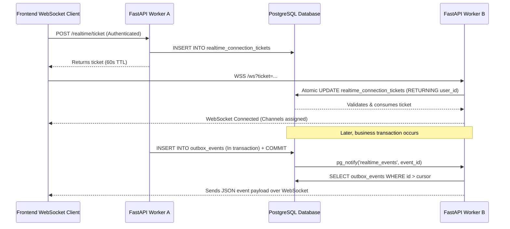

# PostgreSQL-Only Real-Time Architecture Specification

## 1. Overview & Architectural Motivation

Real-time capabilities (live queue updates, doctor consultation alerts, patient notifications) in the Al-Jadreyah Clinic Management System are built entirely upon **PostgreSQL**, with **strict elimination of Redis**.



### Why Redis Was Completely Removed:
1. **Multi-Worker Safety:** Previous in-memory ticket dicts failed in multi-worker environments because Worker B could not validate a ticket issued by Worker A. Centralizing tickets in PostgreSQL solves this across any number of workers.
2. **Dual-Write Inconsistency:** Publishing directly to Redis before or after database commit risks phantom events or lost events during network errors.
3. **Transactional Integrity:** PostgreSQL Outbox guarantees that events are stored in the same atomic database transaction as the business operation. If a booking fails or rolls back, zero phantom events are dispatched.

---

## 2. Component Specifications

### 2.1 Connection Ticket Lifecycle (`realtime_connection_tickets`)
- **Generation (`POST /realtime/ticket`):** Generates a random cryptographic token (`secrets.token_urlsafe(32)`). The SHA-256 hash is saved to `realtime_connection_tickets` with `expires_at = NOW() + 60s`.
- **Consumption (`WSS /ws?ticket=...`):** Atomically executed via SQL:
  ```sql
  UPDATE realtime_connection_tickets
  SET consumed_at = NOW()
  WHERE token_hash = :hash
    AND consumed_at IS NULL
    AND revoked_at IS NULL
    AND expires_at > NOW()
  RETURNING user_id;
  ```
  This is strictly single-use and race-condition free across all workers. Replay attempts immediately return `None` and fail with connection rejection.

### 2.2 Channel Authorization Matrix
Upon successful connection, the worker assigns channels based on authenticated profile identity:
- `queue`: Public waiting room queue (available to all connected clients).
- `user:{user_id}`: Private patient/user channel for personal notifications.
- `doctor:{doctor_id}`: Dedicated channel for doctors receiving consultation queues and lab updates.
- `staff:{role}`: Role-specific broadcast channel (e.g. `staff:reception`, `staff:lab`, `staff:pharmacy`).

### 2.3 Transactional Outbox Delivery Engine
- **Event Recording:** `record_outbox_event(db, channel, event_type, payload)` adds an `OutboxEvent` to the caller's active database session.
- **Trigger Wakeup:** On successful commit, PostgreSQL trigger `trg_outbox_event_notify` executes `PERFORM pg_notify('realtime_events', NEW.id::text);`.
- **Worker Polling & Recovery:** Each worker process runs an asynchronous background engine maintaining its own in-memory `_last_seen_event_id` cursor. Every 500ms (`REALTIME_POLL_INTERVAL_SECONDS`), the worker fetches unread events:
  ```sql
  SELECT * FROM outbox_events WHERE id > :last_seen_id ORDER BY id ASC LIMIT 50;
  ```
- **Local Fan-out:** Fetched events are immediately delivered to connected WebSockets subscribed to the matching channel.

---

## 3. Domain Event Catalog & Privacy Envelopes

To maintain patient privacy, all real-time event payloads contain only identifiers, queue counters, dates, and times. No sensitive diagnoses or medical attachments are broadcast over real-time channels:

| Event Type | Channel | Triggering Action | Payload Data |
| ---------- | ------- | ----------------- | ------------ |
| `appointment.booked` | `public:queue`, `doctor:{id}` | Patient or staff books slot | `appointment_id`, `doctor_id`, `date`, `time` |
| `appointment.cancelled` | `public:queue`, `doctor:{id}` | Patient or staff cancels | `appointment_id`, `doctor_id` |
| `appointment.rescheduled`| `public:queue`, `doctor:{id}` | Appointment time changed | `appointment_id`, `doctor_id`, `date`, `time` |
| `appointment.checked_in` | `public:queue`, `doctor:{id}` | Patient arrives at clinic | `appointment_id`, `doctor_id`, `ticket_number`, `emergency` |
| `appointment.walk_in` | `public:queue`, `doctor:{id}` | Reception registers walk-in| `appointment_id`, `doctor_id`, `ticket_number`, `emergency` |
| `appointment.ticket_issued`| `public:queue` | Queue ticket assigned | `appointment_id`, `doctor_id`, `ticket_number` |
| `visit.started` | `public:queue`, `doctor:{id}` | Doctor calls patient in | `appointment_id`, `doctor_id`, `ticket_number` |
| `visit.finished` | `public:queue`, `doctor:{id}` | Consultation completed | `appointment_id`, `doctor_id` |
| `doctor.late` | `public:queue` | Doctor announces delay | `doctor_id`, `minutes`, `date` |
| `doctor.absent` | `public:queue` | Doctor absence logged | `doctor_id`, `date`, `affected_count` |
| `lab.result_confirmed` | `doctor:{id}`, `staff:lab` | Lab tech confirms test | `order_id`, `patient_id`, `test_name` |
| `notification.created` | `user:{id}` | Personalized user alert | `user_id`, `type`, `params` |
