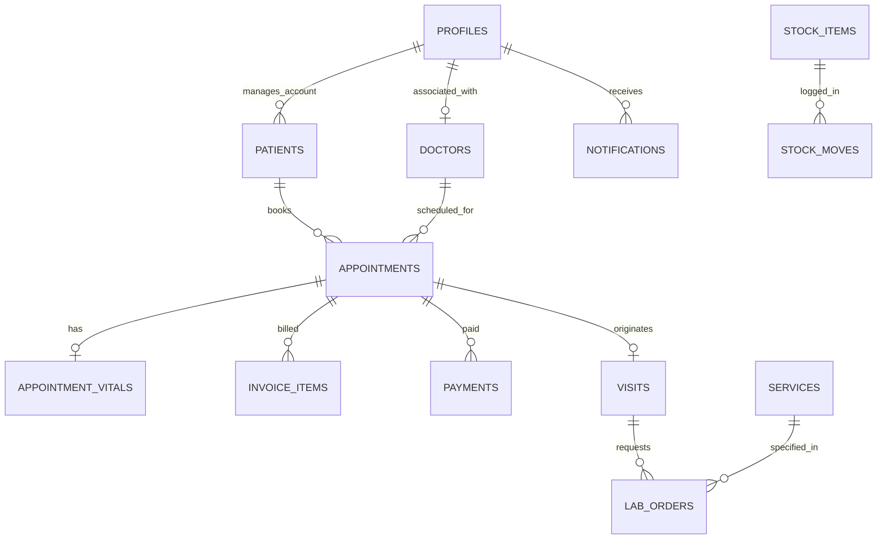

# DATABASE DESIGN & ARCHITECTURE SPECIFICATION
## Al-Jadreyah Clinic Management System

---

## 1. Architectural Principles

The database design for the Al-Jadreyah Clinic Management System adheres to the following core tenets:
- **Single Source of Truth (`backend/database/schema.sql`):** One unified, idempotent DDL file containing tables, types, constraints, indexes, triggers, Row Level Security policies, storage configurations, and seed fixtures.
- **Strict Referential Integrity:** Foreign keys with explicit `ON DELETE RESTRICT`, `ON DELETE CASCADE`, or `ON DELETE SET NULL` semantics.
- **Auditability & Immutability:** Sensitive financial entries (`payments`, `expenses`, `stock_moves`, `audit_logs`) are never updated in place or deleted. Corrections are made via compensatory entries (`reversal`, `refund`, `voided`).
- **Precision Financials:** Monetary amounts are stored using PostgreSQL `NUMERIC` types (`NUMERIC(12, 2)` or `NUMERIC(14, 2)`). Never floating-point representations.
- **Concurrency & Idempotency:** Critical state transitions and reservations use unique indexes (`idx_unique_doctor_active_slot`, `idempotency_key`) and database-level transactional locks to prevent double-booking or duplicate payments.
- **Temporal Integrity:** Time-sensitive medical and operational entities utilize `TIMESTAMPTZ` with timezone normalization.

---

## 2. Entity Relationship Overview

---

## 3. Schema Catalog

### 3.1 Authentication & User Management
- **`profiles`**: Bridges Supabase `auth.users` UUID with numeric IDs expected by the frontend.
  - Columns: `id` (BIGSERIAL PK), `auth_user_id` (UUID UNIQUE FK), `name`, `phone`, `password_hash`, `role` (ENUM: patient, reception, doctor, pharmacy, lab, accountant, manager), `doctor_id` (FK to doctors), `is_active`, `created_at`, `updated_at`.

### 3.2 Facilities & Clinical Practitioners
- **`branches`**: Multi-branch support.
  - Columns: `id` (VARCHAR PK: 'main', 'second'), `name`, `name_ar`, `address`, `created_at`.
- **`doctors`**: Physician profiles, consultation fees, and schedule matrix.
  - Columns: `id` (BIGSERIAL PK), `name`, `name_ar`, `specialty`, `specialty_ar`, `fee`, `new_minutes`, `followup_minutes`, `clinic_percent`, `service_percent`, `days` (JSONB weekly array), `absences` (JSONB date array), `late_date`, `late_minutes`, `created_at`, `updated_at`.

### 3.3 Patient Health Records
- **`patients`**: Master patient registry and family connections.
  - Columns: `id` (BIGSERIAL PK), `name`, `phone`, `account_id` (FK to profiles), `relation` (self, child, parent, spouse, sibling, other), `birth_date`, `allergies` (JSONB array), `conditions` (JSONB array), `blood_type` (A+, A-, B+, B-, AB+, AB-, O+, O-), `created_at`, `updated_at`.
- **`appointment_vitals`**: Vital signs measured before consultation.
  - Columns: `appointment_id` (PK FK to appointments), `patient_id` (FK), `systolic`, `diastolic`, `temperature`, `pulse`, `spo2`, `weight`, `height`, `at`, `by`.

### 3.4 Appointments & Queuing
- **`appointments`**: Scheduled bookings, walk-ins, and queue states.
  - Columns: `id` (BIGSERIAL PK), `patient_id` (FK), `doctor_id` (FK), `date`, `time`, `kind` (new, followup), `branch` (main, second), `status` (booked, arrived, in_progress, done, cancelled, no_show), `emergency`, `arrival_order`, `ticket`, `called_at`, `cancel_reason` (patient, doctor_absent), `idempotency_key` (UNIQUE), `created_at`, `updated_at`.
  - Constraint: `idx_unique_doctor_active_slot` partial unique index on `(doctor_id, date, time)` for non-empty times when status is active.

### 3.5 Consultations & Ancillary Orders
- **`visits`**: Clinical consultation records.
  - Columns: `id` (BIGSERIAL PK), `created_at`, `patient_id` (FK), `doctor_id` (FK), `appointment_id` (FK), `diagnosis`, `internal_note`, `medicines` (JSONB), `dispensed`, `follow_up_on`, `rating_stars`, `rating_comment`, `rating_at`.
- **`services`**: Master catalog for laboratory tests, imaging, and minor procedures.
  - Columns: `id` (BIGSERIAL PK), `name`, `name_ar`, `kind` (test, xray, procedure), `price`, `currency` (IQD, USD), `template` (JSONB), `created_at`, `updated_at`.
- **`lab_orders`**: Diagnostic test requests and structured results.
  - Columns: `id` (BIGSERIAL PK), `visit_id` (FK), `patient_id` (FK), `doctor_id` (FK), `service_id` (FK), `status` (requested, entered, confirmed), `result` (JSONB), `history` (JSONB), `requested_at`, `confirmed_at`.

### 3.6 Pharmacy & Inventory
- **`stock_items`**: On-hand medication inventory.
  - Columns: `id` (BIGSERIAL PK), `name` (UNIQUE), `unit` (tablet, capsule, bottle, tube, injection, sachet), `quantity`, `low_level`, `expires_on`, `barcode` (UNIQUE), `price`, `created_at`, `updated_at`.
- **`stock_moves`**: Ledger of every stock quantity modification.
  - Columns: `id` (BIGSERIAL PK), `at`, `by`, `kind` (create, receive, dispense, edit, sale), `stock_id` (FK), `item_name`, `unit`, `change`, `quantity_after`, `note`.
- **`pharmacy_sales`**: Pharmacy revenue tracking (prescriptions and over-the-counter).
  - Columns: `id` (BIGSERIAL PK), `at`, `by`, `kind` (prescription, counter), `customer`, `lines` (JSONB), `total`, `idempotency_key` (UNIQUE).

### 3.7 Financial Operations
- **`invoice_items`**: Immutable line items billed to an appointment.
  - Columns: `id` (BIGSERIAL PK), `appointment_id` (FK), `label`, `label_ar`, `kind`, `price`, `currency`, `created_at`.
- **`payments`**: Transaction settlement logs.
  - Columns: `id` (BIGSERIAL PK), `appointment_id` (FK), `amount`, `currency`, `method` (cash, online), `kind` (payment, refund, reversal), `at`, `by`, `reason`, `ref_id` (FK self-reference), `key` (UNIQUE).
- **`cash_closings`**: Receptionist end-of-shift cash drawer reconciliations.
  - Columns: `id` (BIGSERIAL PK), `by`, `opened_at`, `closed_at`, `payments`, `expected_iqd`, `expected_usd`, `counted_iqd`, `counted_usd`, `difference_iqd`, `difference_usd`, `note`.
- **`expenses`**: Operating clinic expenditures.
  - Columns: `id` (BIGSERIAL PK), `date`, `category` (rent, salaries, power, supplies, medicines, maintenance, other), `amount`, `currency`, `note`, `by`, `at`, `voided_by`, `voided_at`, `voided_reason`.

### 3.8 Clinic Governance
- **`clinic_settings`**: Configurable policy thresholds (single-row table).
  - Columns: `id` (PK=1), `cancel_hours`, `no_show_limit`, `deposit_amount`, `prescription_days`, `usd_rate`, `updated_at`.
- **`audit_logs`**: System-wide administrative action logs.
  - Columns: `id` (BIGSERIAL PK), `at`, `user_name`, `role`, `action`, `target`.
- **`notifications`**: Targeted user alerts.
  - Columns: `id` (BIGSERIAL PK), `user_id` (FK to profiles), `key` (UNIQUE), `type`, `params` (JSONB), `at`, `read`.

---

## 4. Execution & Supabase Setup Instructions

1. Open your **Supabase Dashboard** -> Select your Project.
2. Navigate to the **SQL Editor** tab.
3. Open or copy the entire content of `backend/database/schema.sql`.
4. Paste into the SQL Editor and click **Run**.
5. All extensions, enums, tables, triggers, Row Level Security policies, storage buckets, and initial seed data will execute idempotently and successfully.
